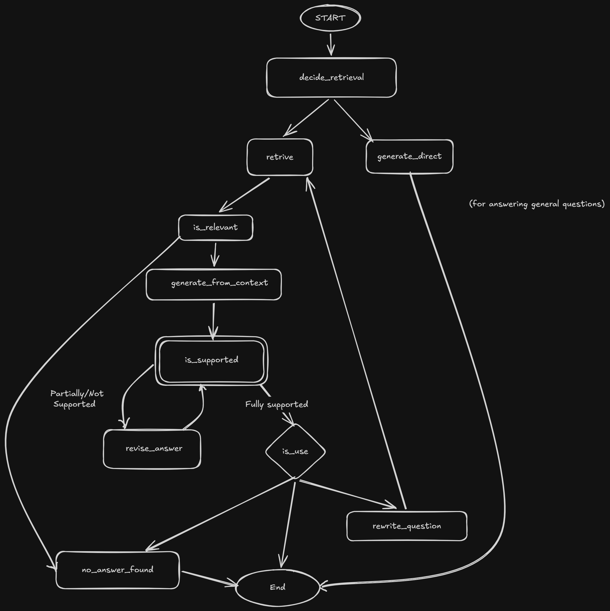

# Self-RAG: Self-Reflective Retrieval-Augmented Generation

## Overview
Retrieval-Augmented Generation (RAG) often struggles with irrelevant retrievals, unfaithful generations, or unhelpful responses. Self-RAG addresses these issues by training or prompting the model to reflect on its own generation process. It dynamically decides when to retrieve information, assesses the relevance of retrieved documents, and evaluates the faithfulness and usefulness of its final response, thereby producing more accurate and reliable answers.

## Architecture

*(Reference diagram: [self-rag.png](images/self-rag.png))*

## Results (Vanilla RAG vs Self-RAG)
| Metric | Vanilla RAG | Self-RAG |
|--------|-------------|----------|
| Faithfulness | __ | __ |
| Correctness | __ | __ |
| Latency | __ | __ |
| Cost | __ | __ |

## Tech Stack
- **Framework**: LangGraph (for orchestration and workflow state management)
- **Language**: Python 3.11+
- **LLMs**: OpenAI (GPT-4o for generation, GPT-4o-mini for critique)
- **Embeddings**: OpenAI (text-embedding-3-small)
- **Vector Database**: PostgreSQL with pgvector
- **Tooling**: `uv` (dependency management), `ruff` (linting/formatting), `pytest` (testing), `pydantic-settings` (configuration)

## How to Run

### Prerequisites
- Python 3.11+
- [uv](https://github.com/astral-sh/uv) (for package management)
- Docker and Docker Compose

### Setup
1. Clone the repository:
   ```bash
   git clone <repo-url>
   cd Self-RAG-Self-Reflective-Retrieval-Augmented-Generation-
   ```
2. Install dependencies using `uv`:
   ```bash
   uv sync
   ```
3. Set up environment variables:
   Copy `.env.example` to `.env` and fill in your API keys (e.g., `OPENAI_API_KEY`).
4. Start the database (PostgreSQL + pgvector):
   ```bash
   docker compose up -d
   ```
5. Run the application (TBD based on entrypoint):
   ```bash
   python -m src.main
   ```

## Project Structure
```
├── app/
│   ├── config.py          # Per-node models, thresholds, loop caps (pydantic-settings)
│   ├── graph/             # State, nodes, edges, routing
│   ├── prompts/           # Versioned prompt files
│   ├── retrieval/         # Ingestion, vector store
│   ├── memory/            # Checkpointer, store, summarizer
│   └── api/               # FastAPI service
├── evals/
│   ├── datasets/          # Golden set (4 buckets)
│   ├── evaluators/        # Node-level + end-to-end
│   └── baseline/          # Vanilla RAG
├── tests/                 # Unit and integration tests
├── docs/                  # Documentation and decision records
├── db/                    # Database init scripts
├── images/                # Architecture diagrams
├── .env.example           # Example environment variables
├── docker-compose.yml     # Docker Compose for PostgreSQL + pgvector
├── pyproject.toml         # Project metadata and dependencies (managed by uv)
└── README.md
```

## Development
- **Linting and Formatting**:
  ```bash
  ruff check .
  ruff format .
  ```
- **Testing**:
  ```bash
  pytest
  ```

## Known Limitations
- __ (To be updated as development progresses)

## License
- __ (Placeholder)